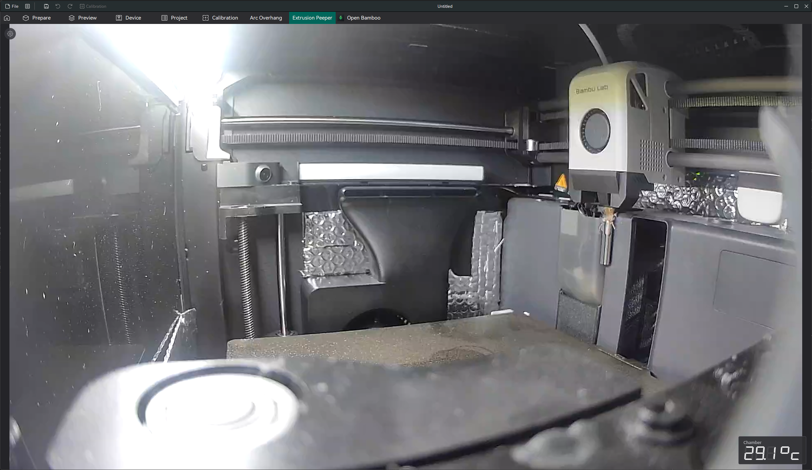

# Extrusion Peeper

Your printer camera shoots at 0.3fps 1mpx, preventing you from obsessing over every little detail of your printer extrusion? You like HOT print chambers at the tip of your fingers? Don't enjoy switching between three apps to monitor a print? Then this is for you!

On a more serious note, Extrusion Peeper does two things:

1. Relays RTSP LAN camera stream to a web page that you can plug into Orca Slicer.
2. Gives an optional overlay with a sensor temp.



# Why

Last year I bought my first printer - a P1S - and very quickly discovered how bad the stock camera was and how important chamber temp was important for filaments like ASA. I got whatever was available at my local hardware store - a Tapo C110 camera and a T310 sensor - and integrated into the slicer, all to a great success and utility. People expressed interest in a more polished solution than watching the stream with VLC, so I decided to share.

# How to

1. Get a Tplink/Tapo camera and set it up to stream over LAN. You'll need the camera host (like an IP - 192.168.1.20), camera login, and password.
2. Get a Tplink/Tapo temperature sensor and place it somewhere in the print chamber. To display temp alongside the video stream, you'll need to put your Tapo credentials into settings.
3. Install Node.js 26.13 or newer and npm 12 (`npm install -g npm@12`), clone this repo, cd into it and run `npm install`, then `npm run start`. npm 12 only runs the install script of `ffmpeg-static`, which downloads FFmpeg. This will create a `settings.json` file - that's where you put the camera and sensor settings.
4. The app will print "You can now peep at extrusions over at: http://localhost:2024". Navigate to the link. If set up correctly and the camera is online, you'll observe the footage. For the sensor, click on the "Settings" button in the top-left corner, choose a sensor from the dropdown and click "Save".
5. To use with Orca Slicer 2.5 or newer, put the peeper into its own tab with the Web Tabs plugin:
   1. Go to "File" > "Plugins", click "Browse plugins" and install "Web Tabs" by Berten. The plugin catalog needs you to sign in to an Orca Cloud account.
   2. Run the plugin's "Manage web tabs" action and add a tab titled "Extrusion Peeper" with the URL "http://localhost:2024" (or whatever you have). This is saved to the plugin's `tabs.json`:

      ```json
      [
        {
          "title": "Extrusion Peeper",
          "url": "http://localhost:2024"
        }
      ]
      ```

   3. Reload the plugin in the Plugins dialog or restart Orca, and the "Extrusion Peeper" tab appears next to "Device".

   On older Orca versions, go to "Device", click on "Camera settings" in the top-right corner of the video section, enter "http://localhost:2024" into the address and press Enter.
6. Bonus: put the peeper into OS startup apps. It passes the camera video through without re-encoding, so it barely uses any CPU, and only while the web page is open.

# Compatibility

These are devices that were confirmed to work:

## Cameras

1. Tapo C110.

The camera has to send H.264 video, which is passed to the page as is.

## Temp sensors

1. Tapo T310
2. Tapo T315

## Slicer

1. Orca Slicer - works on Windows, in a Web Tabs tab on 2.5 or in the Device tab before that. The page plays the video with Media Source Extensions, which Linux builds of Orca only support when the system has an H.264 GStreamer decoder, such as `gstreamer1.0-libav` on Debian and Ubuntu. Not tested on Linux or macOS yet.
2. Bambu Studio - not compatible, there's no setting to set camera stream page URL.

# Contributions

These are very welcome, it's obvious I didn't pay much attention to how easy to use this is or whether it's compatible with many devices.

Run `npm test` for the tests and `npm run typecheck` to check types.

# Extras

1. [Awesome, clean mount for a C110 by HarryKlynn](https://makerworld.com/en/models/180019-p1p-p1s-tapo-c110-v2-internal-camera-mount)
2. [USB to 9v cable to power C110 from internal USB](https://www.aliexpress.com/item/1005005874548376.html?)
